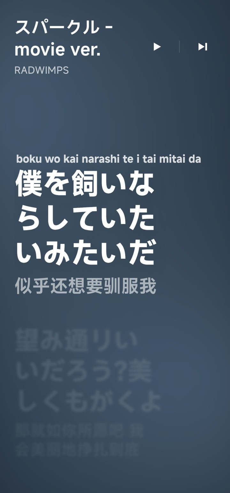
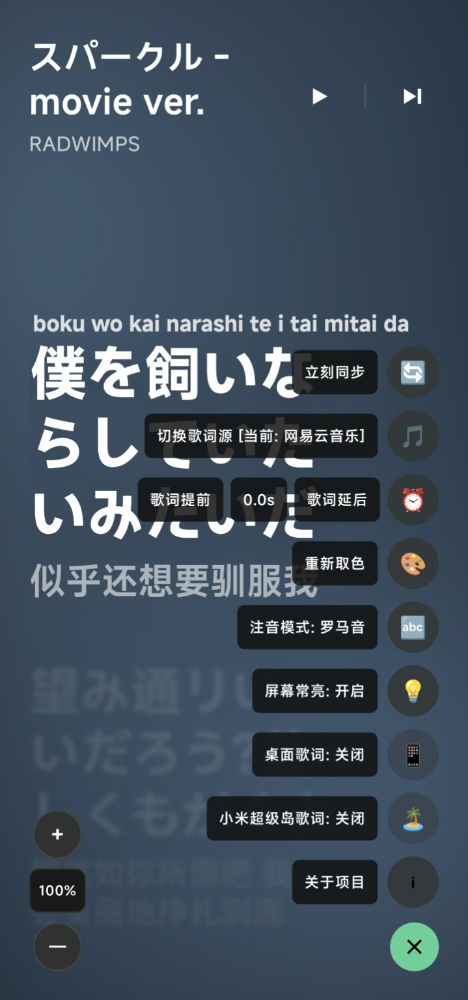

# Lyrics Plus Android

一个基于 Android 的歌词同步显示原型应用。本项目受 PC 端 Spicetify 的 **lyrics-plus** 自定义应用启发，通过监听 Spotify 的本地媒体广播，在安卓设备上实现高颜值、丝滑过渡的歌词同步滚动与特效显示。

---

## 实机截图

<p align="center">
  
  
</p>

左图为歌词主界面，右图为展开后的设置面板。

---

## ⚙️ 手机端配置指南

为了让 App 能够完美接收 Spotify 的播放状态与歌词进度，请在手机上进行以下设置：

### 1. 开启 Spotify 设备广播
在 Spotify Android 客户端中，依次点击：
`设置与隐私 -> 播放 -> 开启“设备广播状态” (Device Broadcast Status)`。
*(注：这是 Spotify 系统的安全机制，必须手动开启后，其他应用才能监听到当前的歌曲切换)*

### 2. 授予通知栏监听权限
首次打开 App 时，点击通知栏访问权（Notification Access）进行授权。
或者手动设置，在系统的特殊权限设置中：
`读取、回复和控制通知 -> 允许“Lyrics Plus”读取通知`。
* **为什么需要这个权限？**：
  * Spotify 本身的本地广播只在歌曲切换或播放状态改变时触发，不会频繁广播微秒级的当前进度。
  * 授权后，App 可以读取 Spotify 活跃媒体会话（Media Session）的播放位置。**即使您刚打开 App、刷新应用或手机息屏锁屏后返回，歌词进度也能瞬间对齐，无需等待下一首歌。**

### 3. 打开设置面板

**点击歌词页面右下角的空白区域**即可展开设置面板，点击面板右下角的“×”可收起。

面板中可切换歌词源、调整歌词偏移和字号，以及设置注音、屏幕常亮、桌面歌词和小米超级岛歌词。

### 4. 开启小米超级岛歌词（可选）

**小米超级岛歌词需要 Shizuku 授权，并需在支持超级岛的小米系统上使用。**

1. 安装并启动 Shizuku，确保其处于运行状态。
2. 回到 Lyrics Plus，点击右下角展开设置面板，开启“小米超级岛歌词”。
3. 在 Shizuku 授权提示中允许 Lyrics Plus；如已拒绝授权，可到 Shizuku 的已授权应用管理中重新允许。

普通歌词显示和桌面歌词不需要 Shizuku 授权。

---

## 🛠️ 编译与安装

1. **直接安装**：
   * 在本仓库的 **Releases** 页面中，直接下载打包好的最新版本正式包 [app-release.apk](app/build/outputs/apk/release/app-release.apk) 在您的 Android 手机上安装。
2. **自行编译**：
   * 用 **Android Studio** 打开项目
   * 直接运行 `app` 配置，或者在终端运行以下命令：
     ```bash
     # 编译 Debug 包
     ./gradlew.bat assembleDebug
     
     # 编译 Release 发行包（默认读取 scripts/official-build.env 中的公开统计端点）
     ./gradlew.bat assembleRelease
     ```
   * 官方发布构建（包含匿名统计公开端点）：
     ```powershell
     powershell -ExecutionPolicy Bypass -File .\scripts\assemble-official-release.ps1
     ```

---

## 📊 匿名统计

Debug 构建默认不会发送统计事件，因为统计端点为空。Release 构建默认读取
`scripts/official-build.env` 中的公开端点：`https://lyrics.artria.dpdns.org/v1/events`。
因此本地 `assembleRelease` / `installRelease` 与 GitHub Actions tag 触发的 Release APK 使用同一个统计端点。

统计只包含匿名安装 ID、App 版本、Android SDK、系统语言、功能开关与歌词源成功率等摘要信息，不收集歌曲名、歌手名、Spotify 账号或设备唯一标识。详情见 [docs/telemetry.md](docs/telemetry.md)。

---

## ⚖️ 开源协议

本项目采用 **GNU General Public License v3.0 (GPL-3.0)** 协议开源。

### 协议选择依据：
由于本项目在设计理念与功能逻辑上深度参考了 PC 端著名的 **Spicetify lyrics-plus** 自定义应用（其所属的 Spicetify 整个生态采用 **GPL-3.0** 协议），根据开源协议的传染性与合规性要求，本项目同样采用 **GPL-3.0** 开源，以促进开源社区的健康发展与二次创作。
